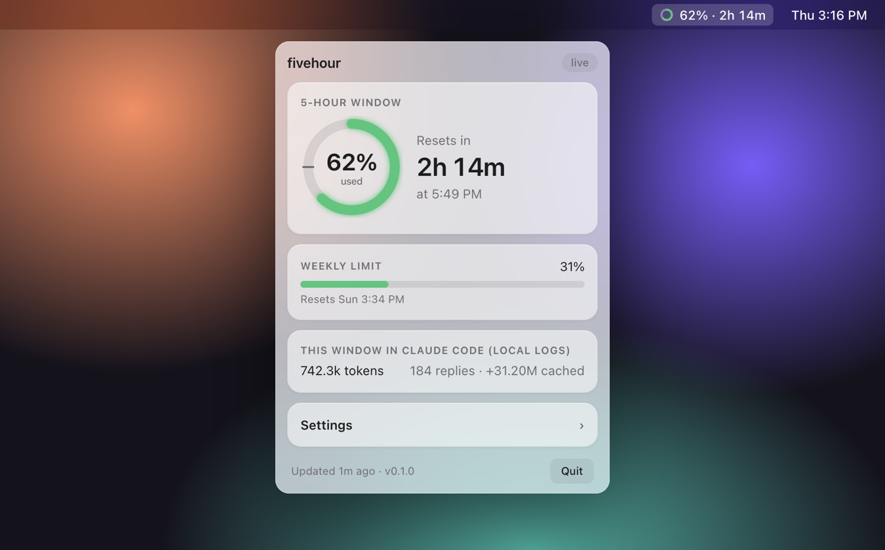

<div align="center">


# fivehour

**Your Claude 5-hour usage limit, always in view.**

See how much you've used, when it resets, and get alerts before you run out, right in your menu bar or system tray.

[](https://github.com/Luchitha7/fivehour/releases/latest)
[](https://github.com/Luchitha7/fivehour/releases)
[](https://github.com/Luchitha7/fivehour/actions/workflows/ci.yml)
[](LICENSE)


[**⬇ Download**](https://github.com/Luchitha7/fivehour/releases/latest) · [Features](#features) · [Set up](#set-up-one-minute) · [Privacy](#privacy-and-security) · [Contributing](CONTRIBUTING.md)

<br>



<sub>Unofficial community project. Not affiliated with or endorsed by Anthropic.</sub>

</div>

<br>

## Features

- **% used** of the current 5-hour window, as a ring icon in the menu bar or system tray
- a **countdown to reset**, plus the clock time it resets at
- your **weekly limit**
- **notifications** you control:
  - when you've used a set share of the limit (default **75%**; choose 50 to 95% or off)
  - a set time before the window resets (default **1 hour**; choose 15 min to 2 hours or off)
  - when a fresh window is available
- **window anchoring** (optional): start your 5-hour windows on *your* schedule
- **update notice**: a notification and a Download button when a new version is out

## Why

The 5-hour window starts with your **first message**, not on a fixed clock. Say you send one quick message at 11:00 and then nothing for hours. When you start a big task at 15:30, you only have 30 minutes left in a window you barely used. Then the next window runs out halfway through the task.

fivehour makes the window visible, so you can plan big tasks around it.

## Download

**[⬇ Download the latest version](https://github.com/Luchitha7/fivehour/releases/latest)**

| Your computer | File to download |
| --- | --- |
| Mac with Apple Silicon (M1, M2, M3, M4…) | `fivehour-…-mac-arm64.dmg` |
| Mac with Intel | `fivehour-…-mac-x64.dmg` |
| Windows (most PCs) | `fivehour-…-windows-x64-setup.exe` |
| Windows on ARM | `fivehour-…-windows-arm64-setup.exe` |
| Linux | `fivehour-…-linux-x86_64.AppImage` |

You also need [Claude Code](https://docs.claude.com/en/docs/claude-code) and [Node.js](https://nodejs.org) (LTS).

### First launch

fivehour isn't signed with a paid Apple or Microsoft certificate yet, so the first launch shows a warning. That's expected:

- **Mac:** open the `.dmg` and drag fivehour into **Applications**. Open it. When macOS blocks it, go to **System Settings → Privacy & Security**, scroll down, and click **Open Anyway**.
- **Windows:** if you see "Windows protected your PC", click **More info → Run anyway**.
- **Linux:** run `chmod +x fivehour-*.AppImage`, then open it.

### Set up (one minute)

1. The fivehour panel opens on first launch. Later, click the ring icon in your menu bar (Mac) or system tray (Windows/Linux) to open it.
2. Click **Connect**.
3. Send any message in Claude Code. Your real usage appears.
4. Optional: in **Settings**, turn on **Start at login** and choose when you want notifications.

### Can't see the icon?

- **Windows:** new tray icons start hidden. Click the **^** arrow next to the clock, then drag the fivehour ring onto the taskbar so it always shows. (Or go to *Settings → Personalization → Taskbar → Other system tray icons* and turn fivehour on.)
- **macOS:** if your menu bar is full, the notch can hide the icon. Close a few menu bar apps, or turn on **Settings → Floating widget** in fivehour.

## Windows notes

fivehour works on Windows 10 and 11. A few things that are different from macOS:

| | |
| --- | --- |
| **Node.js is required** | The status line script runs with Node.js. If you installed Claude Code with its native Windows installer, you may not have Node yet. Install the **LTS** version from [nodejs.org](https://nodejs.org), then restart fivehour. If Node is missing, **Connect** tells you instead of failing silently. |
| **Where files live** | `~/.claude` means `%USERPROFILE%\.claude` (for example `C:\Users\you\.claude`). fivehour's own data is in `%USERPROFILE%\.fivehour`. |
| **Running from source** | Use PowerShell or Windows Terminal. The commands in *Run from source* work as written. |
| **Window anchoring** | Needs the `claude` command to work in a new terminal. If it doesn't, anchoring shows "`claude` command wasn't found". |
| **Notifications** | Appear in the Windows notification center. If you don't see any, check that *Focus assist / Do not disturb* is off. |

## What "Connect" does

Claude Code already knows your 5-hour % and reset time, because Anthropic sends them back with every reply. Claude Code can pass them to a **status line**: a small script it runs after each reply.

**Connect** adds one entry to `~/.claude/settings.json` that runs fivehour's script. The script saves your usage to `~/.fivehour/usage.json`, and the tray app reads it.

- Your settings file is backed up to `settings.json.fivehour.bak` first, and written atomically.
- If you already had a status line, fivehour keeps running it and shows its output.
- **Disconnect** puts everything back the way it was.

## Where the numbers come from

| Source | What | Accuracy | Default |
| --- | --- | --- | --- |
| **Claude Code status line** | Claude Code's `rate_limits.five_hour` / `seven_day` (% used and reset time) | Exact, account-wide (includes claude.ai usage) | On after **Connect** |
| **Local logs** | Tokens in the current window, read from `~/.claude/projects/**/*.jsonl` (same idea as [`ccusage blocks`](https://github.com/ccusage/ccusage)) | Estimate, Claude Code only. Shows **~%**: tokens vs your busiest window in the last 30 days, or scaled by your last exact reading once fivehour has seen one | On |
| **Live polling** | The endpoint behind Claude Code's `/usage`, using your existing Claude Code login | Exact, but **undocumented** and may break | Off |

Live polling checks every 5 minutes and keeps the last good reading. If Anthropic answers "too many requests" (HTTP 429), it waits at least 10 minutes before trying again.

Estimated numbers have a `~` in front, and the "% used" notification only fires on exact numbers.

The status line updates when Claude Code gets a reply. If you only use claude.ai for a while, the % can lag until your next Claude Code message, unless live polling is on.

## Privacy and security

- Everything stays on your machine. fivehour makes only two kinds of network request:
  - **Live data** (only if you turn it on) talks to `api.anthropic.com` over HTTPS using the login Claude Code already stored. fivehour never stores or logs that token.
  - **Update check**: once a day it asks GitHub for the latest fivehour release. No personal data is sent. You can turn it off in Settings.
- fivehour never downloads or installs updates by itself. It tells you, and the **Download** button opens the release page.
- The UI runs in sandboxed, context-isolated windows with a strict Content Security Policy, and can't navigate or open new windows.
- Settings coming from the UI are validated against an allow-list before they're saved.

See [SECURITY.md](SECURITY.md) to report a vulnerability.

## Window anchoring

Turn it on in Settings and enter times like `08:00, 13:00`. At each time, **if no window is running**, fivehour sends one tiny `claude -p` message (Haiku), so a new window starts right then. With `08:00`, your windows run 8-13, 13-18 and 18-23. Needs the `claude` CLI on your PATH.

## Run from source

```bash
git clone https://github.com/Luchitha7/fivehour.git
cd fivehour
npm install
npm start       # run the app
npm test        # unit tests, no Electron needed
npm run dist    # build installers for the OS you're on (output in dist/)
```

### Releasing

Tag a version on `main` and GitHub Actions builds the Mac, Windows and Linux installers and publishes them on the [Releases](https://github.com/Luchitha7/fivehour/releases) page. The full steps are in [CONTRIBUTING.md](CONTRIBUTING.md#versioning-and-releases).

## Development

```
src/main.js                 tray, popup, timers, notifications
src/config.js               settings with validation
src/usage.js                merges sources into one snapshot
src/alerts.js               notification rules
src/anchor.js               window anchoring
src/env.js                  find node / claude from a GUI app
src/icon.js                 ring tray icon -> PNG, no native deps
src/install.js              connect/disconnect the Claude Code status line
src/hook/statusline.js      status line script (copied to ~/.fivehour/)
src/sources/local-logs.js   5h block estimate from local logs
src/sources/endpoint.js     opt-in live data
src/update.js               daily "update available" check
src/ui/                     popup and widget
```

App data lives in `~/.fivehour/`.

## Contributing

PRs are welcome. [CONTRIBUTING.md](CONTRIBUTING.md) covers setup, branch and commit naming, and how pull requests are reviewed and merged.

## Roadmap

- Custom % and minutes, not just presets
- History: how much of each window you actually used
- Per-project breakdown from local logs
- Signed and notarized installers, Homebrew and winget

## License

[MIT](LICENSE)
